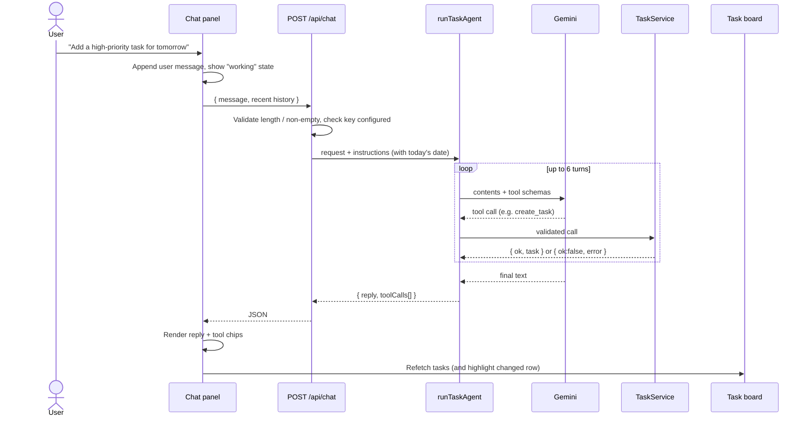
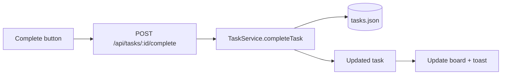
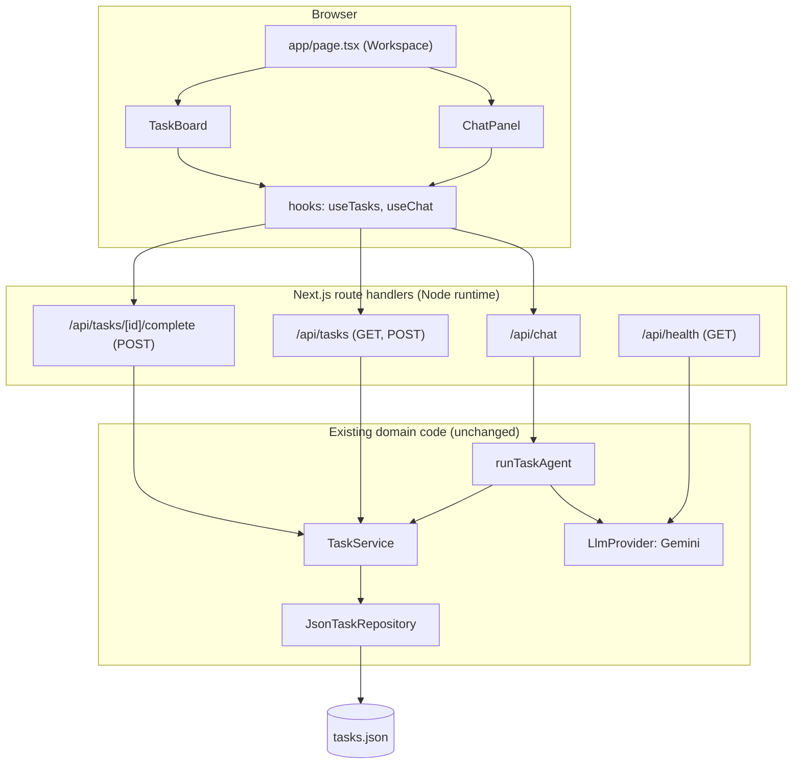

# Frontend Plan: Next.js + shadcn/ui

Status: **implemented as part of Version 1**. Deviations from this plan are listed at the end. Extends `ARCHITECTURE.md` (which listed the Next.js UI as a future step) and keeps `PRD.md` / `FRD.md` rules unchanged.

## 1. Goals and non-goals

**Goals**
- A local web UI for the existing task agent: chat in natural language, see and manage tasks visually.
- Reuse the existing domain code (`src/services`, `src/repositories`, `src/tools`, `src/llm`) unchanged where possible.
- Show what the agent actually did (tool calls and results), so "no false success" is visible to the user.

**Non-goals (still V1 rules)**
- No auth, multi-user, deletion, reminders, or database. Single user, single process, `tasks.json`.
- Not deployed publicly. Runs on `localhost` only; the Gemini key stays server-side.

## 2. Screens

One primary screen plus a few overlays. Keep it small.

| # | Screen | Purpose | shadcn components |
|---|--------|---------|-------------------|
| 1 | **Workspace** (`/`) | Chat on the left, task board on the right. This is the whole app. | `resizable` or plain grid, `card`, `scroll-area` |
| 2 | **Chat panel** | Message list, input box, suggested prompts, per-message tool-activity chips ("Created task *X*", "Listed 3 tasks", "Failed: not found"). | `textarea`, `button`, `badge`, `skeleton` |
| 3 | **Task board** | Tabs: All / Open / Overdue / Completed. Rows show title, priority badge, due date (red if overdue), status. Row action: Complete. | `tabs`, `table` or `card` list, `badge`, `button`, `tooltip` |
| 4 | **Task detail** (overlay) | Full task fields, ID with copy button, created/completed timestamps. | `sheet`, `button` |
| 5 | **New task dialog** (overlay) | Optional manual form (title, description, priority, due date) that calls the same service without the LLM. | `dialog`, `form`/`input`, `select`, `calendar`+`popover` |
| 6 | **Status/Settings** (overlay) | Shows provider, model, whether the key is configured, business timezone, and storage path. Read-only in V1 (config stays in `.env`). | `dialog`, `badge` |
| 7 | **Empty / error states** | No tasks yet, API key missing, model quota (429) or timeout (504), storage corrupted. | `alert`, `sonner` toasts |

Responsive: on narrow screens the Workspace becomes two tabs (Chat | Tasks) instead of two columns.

## 3. Interaction flows

### 3.1 Agent flow (natural language)



Rules the flow must keep:
- The reply is never shown as "done" unless the tool trace shows `ok: true`. The chips come from the real trace, not the model text.
- Ambiguous date or missing ID: the agent asks a question; the UI just shows it as a normal assistant message and the user answers in the same thread.
- Errors (429, 504, storage) appear as an inline error bubble with a Retry button, and never as a fake assistant answer.

### 3.2 Direct UI flow (no LLM)

Clicking **Complete** on a row, or submitting the New task dialog, calls plain REST routes that use `TaskService` directly. This is deterministic, free, and instant; the chat is only for natural language.



### 3.3 Task completion via chat

The CLI rule "completion needs an explicit ID" is awkward in a GUI. Proposed: the history sent with each chat request includes earlier tool results (which contain IDs), so "complete the first one" works after a list. If still unclear, the agent asks. Open decision D2 below.

## 4. Architecture



### Structure (same repo, no monorepo)

```text
src/
  app/                    # Next.js App Router
    layout.tsx, page.tsx, globals.css
    api/chat/route.ts
    api/tasks/route.ts
    api/tasks/[id]/complete/route.ts
    api/health/route.ts
  components/
    ui/                   # shadcn generated
    chat/ChatPanel.tsx, Message.tsx, ToolChips.tsx
    tasks/TaskBoard.tsx, TaskRow.tsx, TaskSheet.tsx, NewTaskDialog.tsx
    StatusDialog.tsx
  lib/
    server.ts             # singleton TaskService + provider (server only)
    api-client.ts         # typed fetch helpers
  (existing) agent.ts, llm/, services/, repositories/, schemas/, tools/, index.ts (CLI stays)
```

The CLI (`npm run dev`) keeps working; the web app is a second entry point to the same domain.

### Key technical decisions

| Topic | Decision | Reason |
|-------|----------|--------|
| Rendering | App Router; page is a client component, all data via `fetch` to route handlers | Simple; no server actions needed |
| Server state | Singleton `TaskService` in `lib/server.ts`; route handlers run in the Node runtime | `fs` access; one process matches the JSON-storage limit |
| Validation | Reuse Zod schemas from `src/schemas` in route handlers | One source of truth for rules |
| Client data | Plain `fetch` + small hooks (no React Query) | YAGNI; add it if refetch logic grows |
| Agent output | Extend `LlmProvider.run` to return `{ text, toolCalls: {name, args, result}[] }` | Lets the UI render honest tool chips |
| Chat memory | Client keeps messages; sends the last N (about 10) turns each request; provider accepts history | Needed for natural multi-turn chat; stays stateless on the server |
| Streaming | Not in V1 (JSON response with a "working" indicator). Add SSE later if latency hurts | Avoids a second code path early |
| Concurrency | Serialize writes in `lib/server.ts` with a simple promise queue | Browser can fire two requests at once; JSON repo is not concurrency-safe |
| Module resolution | Change `tsconfig` to `bundler` resolution + `@/*` alias; existing `.js` import suffixes keep working | Next requires it; verify Vitest and `tsx` CLI still pass |
| Styling | Tailwind v4 + shadcn (default theme, dark mode via `next-themes`) | Requested stack |

### Security
- Gemini key is read only in server code; never imported by client components.
- Route handlers cap message length (e.g. 2,000 chars), reject empty input, and return sanitized errors (status code and short message, no provider internals).
- Bind to `localhost`; no CORS. Add a simple per-process rate limit on `/api/chat` to protect quota.
- Still no tools beyond the three; the UI adds no new model capabilities.

## 5. Build plan

Each phase is verified before the next. Existing tests must keep passing throughout.

| Phase | Work | Exit criterion |
|-------|------|----------------|
| **F0 Setup** | Install `next`, `react`, `tailwindcss`, shadcn init; update `tsconfig`; add `next.config`, `dev:web` / `build` scripts. | `npm run dev:web` serves a blank page; `npm test`, `typecheck`, CLI still work. |
| **F1 Task API** | `lib/server.ts`, `GET/POST /api/tasks`, `POST /api/tasks/[id]/complete`, `GET /api/health`; Zod-validated; write queue. Route tests with in-memory repo. | `curl` can create, list (with filters), complete; bad input returns 400 with a message. |
| **F2 Task board** | Tabs, rows, priority/due badges, Complete button, empty state, task detail sheet, New task dialog. | Manual flows work without any LLM; overdue styling correct at the date boundary. |
| **F3 Chat API** | Extend provider to return tool trace and accept history; `POST /api/chat`; error mapping (429/504/config). Update fake-client tests. | Scripted tests pass; live curl creates a task and returns reply + trace. |
| **F4 Chat panel** | Message list, input, suggested prompts, tool chips, working state, error bubble with Retry; board refetch and row highlight after tool calls. | The three journeys in PRD section 8 work from the browser. |
| **F5 Polish** | Status dialog, dark mode, mobile tabs, keyboard shortcuts (Enter / Shift+Enter), a11y pass (labels, focus, contrast), toasts. | Usable at phone width; keyboard-only flow works. |
| **F6 Docs and verification** | README web section, update `ARCHITECTURE.md`, `BUILDPLAN.md`, `BUILDLOG.md`; manual smoke checklist; production `next build` passes. | Docs match behavior; build and tests green. |

Estimated effort: F0 0.5h, F1 1h, F2 2h, F3 1.5h, F4 2h, F5 1.5h, F6 1h (about 9-10 hours).

## 6. Testing strategy
- **Unit/route tests (Vitest):** route handlers with in-memory repository, validation errors, serialized writes, chat route with scripted fake Gemini client (tool trace, history, 429/504 mapping).
- **No live API in default tests;** a short manual smoke list for the live agent.
- **UI:** manual checklist per phase; add Playwright only if the UI starts regressing (YAGNI for V1).

## 7. Open decisions (need your call)

| ID | Question | Recommendation |
|----|----------|----------------|
| D1 | Include manual New task dialog and Complete button (bypass the LLM)? | Yes. Cheap, deterministic, and makes the UI useful even when quota is exhausted. |
| D2 | Allow completing by title/position in chat ("complete the first one") using history, or keep "explicit ID only"? | Allow via history from tool results; still ask when more than one task matches. |
| D3 | Chat memory: client-held history (stateless server) or persisted conversations? | Client-held, cleared on refresh. No new storage. |
| D4 | Streaming responses now or later? | Later. |
| D5 | Same repo (shared `src/`) or split into `apps/web` + package? | Same repo. |
| D6 | Dark mode and mobile layout in V1? | Yes, both come almost free with shadcn. |

## 8. As built: deviations from this plan

- **Mobile layout:** stacked (tasks on top, chat below, half the height each) instead of Chat/Tasks tabs; on desktop the chat is on the right.
- **Task cards in chat:** added beyond the plan. List results render as a horizontal strip of cards with a status chip and Complete button, showing live status from the board.
- **Due date input:** the New task form uses the native date input instead of the calendar popover.
- **Model context:** earlier tool results go in the system instruction (not as text in assistant turns) after the model echoed them into replies.
- **Scope guardrails:** instruction rules plus a code-block backstop, added after testing showed off-topic answers.
- **Not done (by decision):** streaming responses (D4), Playwright tests (manual smoke checklist in `README.md` instead).
- **Decisions D1 to D6** were all approved as recommended.
